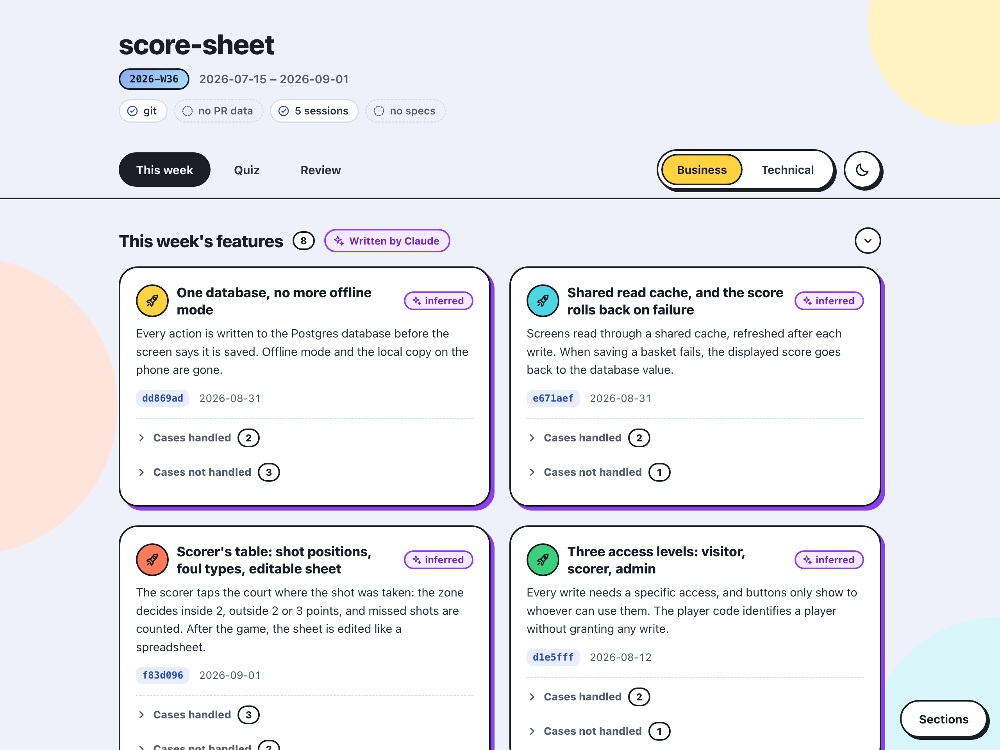
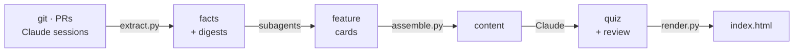

<div align="center">

# debrief

**Your week of code, back in your head.**

A Claude Code skill that turns a week of commits, pull requests and AI sessions into a quiz and a dashboard,<br>
so your team keeps a grip on code it no longer writes by hand.


**[arimet.github.io/debrief](https://arimet.github.io/debrief)**

<br>

<picture>
  <source media="(prefers-color-scheme: dark)" srcset="docs/images/week-dark.png">
  
</picture>

</div>

<br>

## Why

AI writes more of the code every week. Reviews turn into reading and approving, and nobody can quite say anymore what shipped, which rule it follows, or why it was built that way.

Once a week, `/debrief` asks you to **produce before it shows**: retell the week from memory, answer questions on the features and the code, make the decisions the team made. Then it shows you what you missed.

## What you get

<table>
<tr>
<td width="33%" valign="top">

### 📅 This week

The week's features in plain words, with the cases handled and not handled, and the key figures.

Then a part for your role:<br>
**Business**: what changes for users, points to clarify with the client.<br>
**Technical**: hotzones, untested files, blind spots, commit heatmap.

</td>
<td width="33%" valign="top">

### 🎯 Quiz

It opens on a **retelling** of the week, written from memory.

Then 5 to 10 questions: business rules, where the logic lives, why a choice was made, and **what you would have decided**.

</td>
<td width="33%" valign="top">

### 🔍 Review

Your retelling compared with the pull requests, claim by claim.

How the team worked: descriptions, approvals, tests, merge speed.

Your own Claude sessions: framing, evidence, control, and who held the pen.

</td>
</tr>
</table>

## Install

With [skills](https://github.com/vercel-labs/skills):

```bash
npx skills add arimet/debrief
```

Or by hand, with a symlink so a `git pull` updates the skill:

```bash
git clone git@github.com:arimet/debrief.git
ln -s "$(pwd)/debrief/skills/debrief" ~/.claude/skills/debrief
```

| Tool | Needed | For |
|---|---|---|
| [Claude Code](https://claude.com/claude-code) | required | runs the skill, writes summaries, quiz and review |
| Python 3.9+ | required | standard library only. Ships with the Xcode Command Line Tools on macOS. The skill checks it and explains how to install it when missing. |
| git | required | commits, files, authors |
| [`gh`](https://cli.github.com/) | optional | pull requests. Without it, the week is read from git alone. |
| [`glab`](https://gitlab.com/gitlab-org/cli) | optional | GitLab, partial: merge requests are listed, not their files, commits or approvals |

## Usage

In a repository, in Claude Code:

```
/debrief
```

Or in your own words: *"debrief of the week"*, *"quiz me on this week"*, *"what did we ship this week"*.

The page opens in your browser, served on `127.0.0.1`, and saves your answers as you go.

| Option | Effect |
|---|---|
| `--branch NAME` | read this branch instead of the default one. Only pull requests merged into it count. Remembered per repository. |
| `--lang fr` · `--lang en` | language of the page and of everything Claude writes. Remembered. |
| `--since YYYY-MM-DD` · `--until YYYY-MM-DD` | another period. By default, the current week from Monday to today, or the previous week on a Monday. |

```
/debrief --branch develop --lang en
/debrief --since 2026-11-02 --until 2026-11-08
```

### Compare your retelling

Write your retelling at the top of the Quiz tab, then ask Claude:

```
compare my retelling
```

Each claim is marked **matches**, **drifts**, **not in the PRs**, or **vocabulary** when you use another word than the sources (*"subscription"* where the PR says *"option"*). The features you never mentioned are listed. Reload the page to read it in the Review tab.

## How it works



1. **Extract**, no AI: commits, merged pull requests, hotzones, untested files, migrations, dependencies, blind spots (files changed this week whose history you never touched), team signals, and a redacted digest of each of your Claude sessions.
2. **Summarize**: up to 8 subagents in parallel write one card per feature. Every statement is tagged with its source: `pr`, `spec`, `commit`, or `inferred` when it was only read in the code.
3. **Assemble**, no AI: cards are merged. Dependency, CI, test-only and release PRs are listed without a summary.
4. **Quiz and review**: Claude writes the questions, starting with your blind spots and the risky files.
5. **Validate and render**: every file, commit and id is checked before one self-contained HTML page is built.

About 5 minutes for a week of 100 commits and 30 pull requests. A rerun reuses the cards of unchanged pull requests.

## What it relies on

**Sources**, all read on your machine:

- **git** at the analyzed branch: commits, files, authors, `.mailmap`, renames
- **Pull requests** through `gh`: description, files, commits, reviews
- **Specs and docs** changed during the week
- **Your Claude Code sessions** on this repository, from `~/.claude/projects/`, redacted first

**Signals** it measures:

| Signal | Meaning |
|---|---|
| `no_human_approval` | merged without a human approval |
| `empty_description` | no real description |
| `fast_large_merge` | 400+ lines merged within 30 minutes |
| `ai_without_tests` | AI co-authored commit that touches no test |
| `tests_weakened` | assertions or test cases removed while the code changed |
| who holds the pen | share of your messages to Claude that only approve |

**Ideas** it builds on:

- [conversation-review](https://github.com/arimet/conversation-review): the session parser, the redaction and the Intent · Evidence · Control grid
- Thomas Pierrain, [*Back in the equation*](https://medium.com/@tpierrain/back-in-the-equation-218cecb4c2cd): passivity is what loses the grip on the domain, so the tool asks and the human produces

## Privacy

- 🔒 **Nothing leaves your machine.** The page is served on `127.0.0.1`, answers go to a local file, and `.debrief/` is kept out of git.
- 🙅 **Nobody is ranked.** The quiz never asks who wrote what, and the review is about the team.
- 🧽 **Sessions are redacted** before Claude reads them: keys, tokens, `.env` values, emails, your home path.

## Limits

- Claude Code sessions only, from this machine.
- GitLab support is partial.
- A rebase-merged pull request whose commits are gone is read from its merge commit only.

## Development

```bash
python3 -m unittest discover -s tests -v
```

```
skills/debrief/SKILL.md          the skill: steps, and the rules for cards, quiz and review
skills/debrief/scripts/          extract, assemble, validate, render, serve (Python stdlib)
skills/debrief/scripts/template.html   the page
tests/                           unit tests
docs/specs/                      design spec
```

## License

MIT
